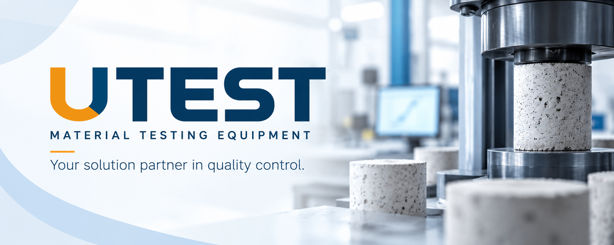

  <picture>
    <source media="(prefers-color-scheme: dark)" srcset="./assets/banner-dark.png" />
    <source media="(prefers-color-scheme: light)" srcset="./assets/banner-light.png" />
    
  </picture>

  <a href="https://www.utest.com.tr/en">Website</a> ·
  <a href="https://www.utest.com.tr/en/23101/Products">Products</a> ·
  <a href="https://www.linkedin.com/company/utestgroup/">LinkedIn</a> ·
  <a href="https://www.utest.com.tr/en/23656/Contact">Contact</a>

## About UTEST

**UTEST Material Testing Equipment** designs, manufactures and supplies testing machines and laboratory equipment for construction materials. Based in **Ankara, Türkiye**, UTEST develops solutions for quality control, materials testing and research applications.

## Testing solutions

**Soil** · **Aggregate** · **Concrete** · **Cement** · **Asphalt & Bitumen** · **Rock** · **Universal Testing Systems** · **Special Testing Systems**

## Engineering & technology

UTEST combines mechanical engineering, manufacturing, instrumentation and software to deliver testing equipment for laboratories, universities, industry and public institutions.

Publicly documented systems include automated machine control, test-data acquisition, real-time visualization and reporting. Applicable test standards and technical specifications are detailed in UTEST's product documentation.

---

Your solution partner in quality control.

